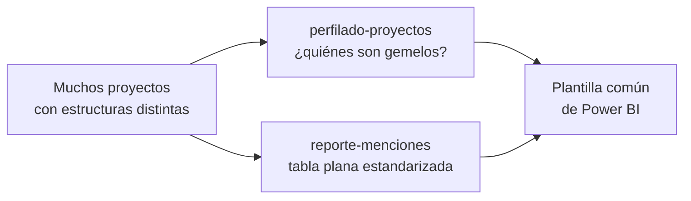

# PostgreSQL para reportes de menciones en Power BI

Dos piezas de **SQL para PostgreSQL** que trabajan sobre el mismo modelo de datos: una plataforma
de monitoreo de medios en la que cada proyecto (cliente, campaña...) tiene sus propias tablas.

| Tabla | Contenido |
|---|---|
| `mencion_pXXX` | una fila por mención; casi todo el detalle va en una columna `data` JSONB |
| `nodo_pXXX` | catálogo de etiquetas (*nodos*): Tono, Temas, Voceros... |
| `mencion_nodo_pXXX` | enlace mención ↔ etiqueta |

## Contenido

| Carpeta | Qué resuelve |
|---|---|
| [`perfilado-proyectos/`](perfilado-proyectos/) | Compara columnas, claves JSONB y tipos de etiqueta entre muchos proyectos y **agrupa los que tienen el mismo perfil**, para saber cuáles pueden compartir plantilla de reporte. |
| [`reporte-menciones/`](reporte-menciones/) | Función que convierte un proyecto en **una tabla plana de 34 columnas** lista para Power BI, reescrita para ser mucho más rápida **sin cambiar ni una fila de la salida**. |

## Cómo encajan

Las dos piezas estandarizan los tipos de etiqueta de la misma forma (`Tono`, `Tonalidad`,
`TONO ` → `TONO`), así que lo que el perfilado dice que es común es lo que el reporte pone en la
misma columna.

## Técnicas que se ven en el código

- SQL dinámico seguro con `format('%I')` y validación del parámetro.
- Optimización guiada por el plan: funciones SQL inlineables, CTE `AS MATERIALIZED`,
  `ARRAY_AGG ... FILTER`, `jsonb_to_record()`, índices cubrientes y parciales.
- Verificación de equivalencia entre versiones con `EXCEPT ALL` en los dos sentidos.
- Perfilado de esquemas con `information_schema`, `jsonb_object_keys()` y agrupación por "firma"
  con `STRING_AGG`.

## Licencia

[MIT](LICENSE)
