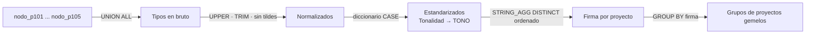

# Perfilado y agrupación de columnas entre proyectos (PostgreSQL)

Cinco consultas de **PostgreSQL** para comparar la estructura de muchos proyectos que viven en
tablas paralelas (`mencion_p101`, `mencion_p102`...). Muestran qué columnas, claves JSON y tipos de
etiqueta comparten, y **agrupan los proyectos que tienen exactamente el mismo perfil**. Así se
sabe cuáles pueden usar la misma plantilla de reporte en Power BI.

## El problema

Todos los proyectos nacen de la misma plataforma, pero con el tiempo cada uno acumula columnas,
claves dentro de su JSONB y tipos de etiqueta propios, a veces escritos de forma distinta
(`Tono`, `Tonalidad`, `TONO `). Antes de diseñar una plantilla común hay que responder:

- ¿Qué tienen **todos** en común?
- ¿Qué es particular de **algunos**?
- ¿Qué proyectos son **gemelos** y pueden compartir plantilla?

## Las consultas

Todas están en [`sql/perfilado_columnas_proyectos.sql`](sql/perfilado_columnas_proyectos.sql).

| # | Pregunta | Técnica |
|---|---|---|
| 1 | ¿Qué columnas físicas comparten las tablas? | `information_schema.columns` + `STRING_AGG` |
| 2 | ¿Qué claves del JSONB `data` comparten? | `jsonb_object_keys()` + `COUNT(DISTINCT)` |
| 3 | ¿Qué tipos de etiqueta tiene cada proyecto, tal como están escritos? | `UNION ALL` + conteo |
| 4 | ¿En cuántos proyectos aparece cada tipo **estandarizado**? | normalización + diccionario `CASE` |
| 5 | ¿Qué proyectos tienen **exactamente** el mismo perfil? | "firma" por proyecto + `GROUP BY` firma |

### Cómo funciona la consulta 5

Ejemplo de salida (datos ilustrativos):

| Proyectos | Cantidad de Proyectos | Nodos Coincidentes |
|---|---|---|
| 101, 103, 104 | 3 | CUBRIMIENTO, TEMAS, TONO, VOCEROS |
| 102 | 1 | FORMATO, TEMAS, TONO |
| 105 | 1 | ENTIDADES_ADSCRITAS, TEMAS, TONO, VOCEROS |

En este ejemplo, 101, 103 y 104 pueden compartir una plantilla, y 102 y 105 necesitan la suya
o una adaptación.

## Detalles que importan

- **La normalización se hace en un solo sitio**, antes del clasificador: mayúsculas, sin espacios
  laterales y sin tildes. Por eso el diccionario usa `LIKE` en lugar de `ILIKE`: el texto ya viene
  en mayúsculas.
- **El diccionario es la única fuente de verdad**: para homologar una variante nueva se añade una
  sola línea al `CASE`.
- **Se excluyen las marcas operativas** (`GESTIONADO`, `COMUNICADO`, `TIER`) para comparar solo el
  esqueleto analítico de cada proyecto.
- **Caso borde:** si un proyecto entra con identificador vacío, `''::INT` rompe la consulta.
  Con `NULLIF(proyecto, '')::INT`, ese proyecto se ordena como `NULL` y la consulta sigue.
- Las consultas son de **solo lectura**. La consulta 5 puede guardarse como vista
  (`CREATE VIEW`), que está comentada en el script.

## Cómo usarlo

1. Abre el script en tu cliente de PostgreSQL (pgAdmin, DBeaver, psql...).
2. Cambia en cada consulta la lista de tablas por las de los proyectos que quieras comparar.
3. Ejecuta las consultas una a una.

## Licencia

[MIT](../LICENSE)
